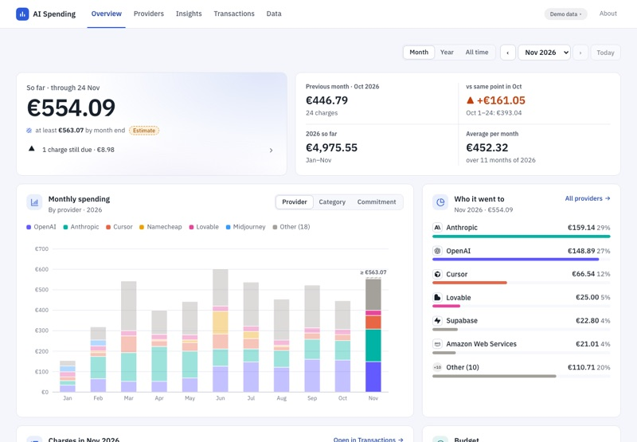

# AI Spending Tracker

**Do you know what you're still paying for?** A free, open-source dashboard that finds your AI subscriptions in the bank statements you already have, and flags price jumps and overlapping plans. No account, no bank linking, no upload.

[](https://github.com/onahum2023/ai-spending-tracker/actions/workflows/ci.yml)
[](LICENSE)

**[Try the demo →](https://ai-spend-tracker.neotixhq.com/?demo=1)** (invented data, nothing saved) · [Open the app](https://ai-spend-tracker.neotixhq.com)



Everything runs in your browser and your data is never uploaded, unless you choose to ask Claude about statement lines with your own Anthropic API key. Data is stored in IndexedDB on your device. There is no backend, account, cookie or analytics. See the [privacy statement](src/content/privacy.ts) (served as `/privacy.html`).

## Why

You signed up to try one thing and kept paying for it. Two assistants do the same job on two monthly plans. A plan quietly doubled and you noticed three months later. This app reads the statements you already download and shows what each AI service costs, what changed and what overlaps.

## What you get

- **Subscriptions, found for you.** Recurring AI charges are picked out of your statements, with the reasoning one click away.
- **Price jumps, flagged.** A plan that went from €22 to €110 stands out the month it happens.
- **Tools you pay for twice.** Overlaps are grouped, with what they cost together and what ending one would save.
- **Month-end estimate.** A conservative "at least €X by month end", never a forecast.
- **Guesses you fix in one click.** Subscription, usage or one-time: the app's guess stays outlined until you confirm it.
- **Budgets, tags and export.** A monthly budget, Personal or Business tags, and a quarter exported for expenses.
- **Works on desktop and mobile**, in light and dark mode.

More: [features page by page](docs/features.md), [how charges are read](docs/how-it-works.md), [screenshots](docs/screenshots.md).

## Bring your statements

Drop the files you already download. The app picks out the AI charges and shows its reasons; you keep or leave out anything it is unsure about.

- **Excel or CSV** exports from most banks and cards, including American Express. Headers are read in English, Dutch, German and French.
- **Revolut PDF** statements. For other PDFs, export a CSV.
- Amounts are read as **EUR** today.
- Optional **Ask Claude** for lines the rules can't place, using your own Anthropic API key, straight from your browser to Anthropic, and only the lines you choose.

Details: [statement extractor](docs/statement-extractor.md), [CSV format and duplicates](docs/csv-format.md).

## Run it locally

Requires Node.js 20+ (tested on Node 24).

```bash
npm install
```

```bash
npm run dev
```

Open http://localhost:5173. With no data it opens on the Welcome page: **Try it with demo data** or **Import your statements**. To start over, use **Data → Clear local data**.

A hosted copy at <https://ai-spend-tracker.neotixhq.com> behaves the same, and your data stays in your browser either way. To host your own copy (any static host works), see [hosting your own copy](docs/self-hosting.md).

## Documentation

| | |
|---|---|
| [Features](docs/features.md) | What each page does |
| [How it works](docs/how-it-works.md) | Charge types, patterns, insights, the month-end estimate |
| [Statement extractor](docs/statement-extractor.md) | Reading statements, the vendor catalog, Ask Claude |
| [CSV format](docs/csv-format.md) | The ledger format, the duplicate policy, money precision |
| [Demo data](docs/demo-data.md) | Demo mode and the synthetic demo pack |
| [Hosting](docs/self-hosting.md) | Deploying your own copy, what stays private |
| [Development](docs/development.md) | Commands, tests, project layout, versions and licenses |
| [Screenshots](docs/screenshots.md) | The full gallery |

## Contributing

Contributions are welcome: see [CONTRIBUTING.md](CONTRIBUTING.md). To add a vendor, see [Adding a vendor](docs/statement-extractor.md#adding-a-vendor). Release notes are in [CHANGELOG.md](CHANGELOG.md); report vulnerabilities as described in [SECURITY.md](SECURITY.md).

## Ownership and license

AI Spending Tracker is a product of **[NeotixHQ](https://neotixhq.com/)**, a brand legally owned by **[NuCielo ICT B.V.](https://nucielo.io/)** © 2026 NuCielo ICT B.V. The code is released under the [Apache License 2.0](LICENSE), commercial use included. The licence covers the code, not the NeotixHQ or AI Spending Tracker names and logo. Third-party libraries keep their own licenses (`public/third-party-notices.txt`).

Stack: React 19, TypeScript, Vite, Recharts, PapaParse, idb, pdf.js and read-excel-file, with the Anthropic SDK for the optional Ask Claude step.
