# AI Spending Tracker

A local, single-user dashboard for understanding what you spend on AI products and services: how much, on which providers, and how it changes over time.

Everything runs in your browser and your data is never uploaded, unless you choose to ask Claude about statement lines with your own Anthropic API key. Data is stored in IndexedDB on your device. There is no backend, account, cookie or analytics. See the [privacy statement](src/content/privacy.ts) (served as `/privacy.html`).

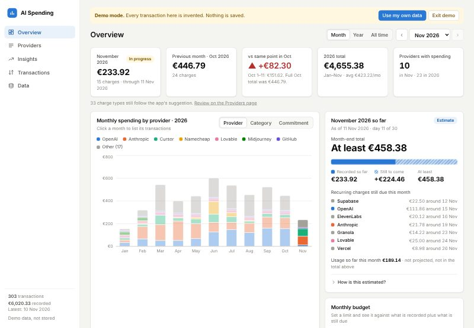

## Run it locally

Requires Node.js 20+ (tested on Node 24).

```bash
npm install
```

```bash
npm run dev
```

Open http://localhost:5173 for the landing page, then **Explore demo data** or **Import your own data**, or go straight to the app at http://localhost:5173/app.html (on Vercel: `/app`). Old links such as `/#/subscriptions` still work: the landing page sends them to the app. On first visit the app shows the welcome screen:

- **Explore demo data** generates invented data in memory (see [Demo mode](#demo-mode)). Nothing is saved.
- **Bank or card statements**: drop the exports you already download from your bank or card; the app picks out the AI charges (see [Statement extractor](#statement-extractor)).
- **Ledger CSV**: import a file that is already in the ledger format. **Download example CSV** saves one to look at.

On later visits your stored data loads automatically. To start over, use **Data → Clear local data**.

Other commands:

```bash
npm test            # financial calculation and data integrity tests
npm run build       # type-check + production build into dist/
npm run preview     # serve the production build
npm run demo:data   # regenerate the synthetic demo pack (see below)
npm run licenses    # rewrite public/third-party-notices.txt from the lockfile (run after changing dependencies)
npm run licenses:check  # fail on a non-permissive dependency license or an out-of-date notices file
```

## What it does

| Page | What you get |
|---|---|
| **Overview** | Spending for the selected month (default: latest recorded month), previous month, month-over-month change (like-for-like when the month is still in progress), year total, number of providers, a monthly chart stacked by provider or by category (click a bar to open that month), largest contributors, the month's charges, a current-month estimate, and an optional monthly budget shown against that estimate. Switch between Month / Year / All time in the header. |
| **Subscriptions** | What your recurring charges commit you to: monthly run-rate and per year, a 30-day calendar of expected charges, price changes ("went from €22.49 to €109.38 in Jun"), stopped subscriptions with a check that nothing still charges, overlapping tools ("2 chat assistants · €130/month combined"), and what ending each would save. Every charge gets a type (Subscription, Usage or One-time / Other) that you can correct. See [Insights](#insights). |
| **Providers** | All providers with all-time total, spending in the selected period, share, transaction count, and first / most recent charge. Search and sort any column. Click a provider for its detail page: monthly chart, recurring-looking patterns, full transaction history, and the merchant descriptors it appears under. |
| **Transactions** | Searchable, sortable table with original merchant descriptors and amounts. Filter by provider and date range (or "Use selected period"). Filters live in the URL, so provider pages and the overview link straight into a filtered view. Click a row to jump to its provider. Each charge can carry a tag (Personal, Business, a client), singly or for everything shown at once. |
| **Trends** | Monthly spending with a 3-month average, year-over-year by calendar month, yearly totals with like-for-like comparison, biggest increases and decreases by provider (last 3 months vs the 3 before, or year to date vs last year), provider concentration (top-1 / top-3 share, providers making up 80%), recurring charges against usage and one-off charges, and recurring-looking patterns. |
| **Data** | Import more CSVs (with a review step), export all transactions as CSV (budgets, corrections, labels, categories and tag rules are not in the file), export one quarter (optionally one tag) for expense claims, clear local data (requires typing `DELETE`), import history, and the duplicate policy in plain language. |

Works on desktop and mobile, in light and dark mode. Provider colours are assigned once by all-time spend and stay the same across every chart; the 7 largest providers get their own colour and the rest share a grey "Other".

## Statement extractor

Most people do not have a clean ledger; they have bank and card statements. The extractor turns those into ledger rows, in the browser:

1. **Read.** Drop one or more files on the welcome screen or the Data page.
   - **Excel (.xlsx) or CSV** exports: the header row and columns are found by name (English, Dutch, German, French), including the American Express transaction export and common bank CSVs (Revolut, ING-style "Af/Bij"). Day/month order and whether charges are positive or negative are worked out from the data.
   - **Revolut PDF statements**: only settled *Account transactions* are used; Pending, Reverted, Pockets and Deposit sections are skipped.
   - Lines that appear in two overlapping files are counted once. Old `.xls`, scanned PDFs and other banks' PDFs are refused with a clear message (export CSV instead).
2. **Decide.** Each line is matched against a vendor catalog (`src/lib/extract/vendors.ts`, about 60 AI vendors plus the hosting, domain and dev-tool services AI projects run on). Every decision carries its reasons:
   - **Provider and type** come from the descriptor where it says so: `CLAUDE.AI SUBSCRIPTION` / `ANTHROPIC* CLAUDE SUB` → subscription, `CLAUDE CERT` → certification, plain `Anthropic` → API usage, `CHATGPT SUBSCR` → subscription, `CHATGPT CREDIT` → usage.
   - **When the descriptor can't tell** (e.g. Lovable sells plans and credit top-ups under one name), the charge pattern decides: repeating monthly at a similar amount → subscription, otherwise usage.
   - **Look-alikes are caught**: Amazon shop purchases are not AWS; `Bck*gamma Utrecht` could be the Gamma DIY store rather than the Gamma AI app; Google One is usually storage. These go to **Needs review** or **Not AI** with the reason shown.
   - Unknown names that look like AI products (`.ai`, `GPT`, ...) go to review. Card repayments, transfers and savings movements are excluded.
   - Hosting, domains and dev tools can be switched off with one checkbox.
3. **Review.** Three tabs (AI charges, Needs review, Not AI). Change any provider or type, or move a line between tabs. Then **Add to the ledger** (duplicates already stored are skipped) or **Download as CSV**.

The statement extractor records a finer type per charge (Subscription, Usage / credits, Certification, Domains, Hosting / infra, Other). It is stored with each transaction and exported as an optional `Type` column. The app itself reads every charge as one of three types, [Subscription, Usage or One-time / Other](#charge-types): Certification, Domains, Hosting and Other count as One-time / Other.

### Ask Claude (optional)

Not needed: without an Anthropic API key, review each **Needs review** line yourself with Include / Exclude. Everything else works the same. Only Anthropic is supported for this step.

For lines still in **Needs review**, **Ask Claude** sends them to Claude (`claude-opus-5-5`, with Anthropic's server-side refusal fallback) using the user's **own** Anthropic API key, straight from the browser to `api.anthropic.com`. Only the review lines are sent, and only: date, amount, the line's description exactly as the bank wrote it (it can include a city or a payment reference), the bank's short name, foreign amount, country and the rules' note. No file names, other columns or other lines. Check the preview and leave out any line you would rather not send. **Show exactly what is sent** displays the payload before anything goes out. Answers come back as structured data; low-confidence answers stay in review. The key stays in memory unless "Remember on this device" is ticked. Nothing is sent unless the button is pressed.

### Adding a vendor

Append an entry to `VENDORS` in `src/lib/extract/vendors.ts`: the provider name, `group` (`ai` or `infra`), a `match` pattern for the upper-cased descriptor, optional `services` for descriptors that name the charge type, and a default `type` (or `'auto'` to decide from the charge pattern). Add a case to `src/lib/extract/extract.test.ts` and run `npm test`. Keep patterns specific: a bare word like `GAMMA` also matches unrelated shops.

## CSV format

```
Merchant,Provider,Amount,Date
OPENAI *CHATGPT SUBSCR  SAN FRANCISCO,OpenAI,22.99,2026-01-14
```

- Column order and header case don't matter. Optional columns: `Type` (Subscription, Usage, ...) and `Tag` (free text, up to 40 characters). Other extra columns are ignored with a warning.
- **Amount** is treated as EUR. Dot decimal, up to 2 decimals, no currency symbol or thousands separator. Negative values (refunds) are accepted.
- **Date** must be a real calendar date in `YYYY-MM-DD`.
- Surrounding whitespace is trimmed; whitespace inside merchant descriptors is kept exactly.

Before anything is saved, the import review shows rows in the file, new rows, rows already stored, and every invalid row with its row number and the reason. Valid rows can be imported while invalid ones are left out.

## Duplicate policy

The source has no transaction IDs, so a record is identified by all four values: **date, provider, merchant descriptor, amount** (exact match).

Identical charges on the same day can be legitimate, so identical rows are never collapsed. Instead counts are compared:

> If a file contains a record **N** times and it's already stored **M** times, **max(0, N − M)** copies are added.

- Re-importing the same file, or an export, adds nothing.
- A newer statement that overlaps an older one adds only the rows that are new.
- A file with two genuinely identical charges keeps both (the review notes it).
- Every skipped row is listed in the review. Nothing is dropped silently.

The duplicate check runs again inside the same IndexedDB transaction that writes the rows, so the result is authoritative.

## Money and precision

Amounts are parsed from text straight into **integer euro cents** (`"12.34"` → `1234`) without going through floating point, and every sum is an integer sum. Floats only appear when drawing chart geometry. Dates are kept as `YYYY-MM-DD` strings and month maths is done in UTC, so time zones can't shift a transaction into another month.

Export writes the same 4-column format with CRLF line endings (plus `Type` and `Tag` columns when any charge has one). Exporting a file in this format reproduces it byte for byte.

## Current-month estimate

Shown on the Overview. It's deliberately simple and deterministic:

1. **Recorded**: everything dated in the current month so far.
2. For each of the previous 3 full months, add up what was spent *after today's day of the month* (e.g. the 10th–31st when today is the 9th).
3. **Estimated additional**: the median of those three amounts. The likely range uses the lowest and highest.
4. **Projected total** = recorded + estimated additional.

The card shows all three inputs, the method in plain language, and which recurring-looking charges usually land later in the month. If there's less than 3 months of history before the current month, or the latest transaction is more than 45 days old, it shows why instead of a number.

For the demo data on 9 Nov 2026: recorded €199.02, estimated additional €394.86, projected €593.88, likely €524.07–€604.83.

## Recurring-looking patterns

These are observations, not confirmed subscriptions. A pattern is a chain of charges from one provider where each charge is in the next calendar month, within 4 days of the previous charge's day of month (or both at month-end), and within 30% of its amount. Charges with the exact same descriptor are chained first, so a subscription isn't interrupted by other charges from the same provider; leftovers are then chained per provider (for descriptors that change every time, like Namecheap's). Descriptors charged 3+ times in one month are treated as usage top-ups and ignored. Chains of 3+ consecutive months are shown, marked **Still appearing** or **Stopped** depending on whether the next charge is due yet.

This separates plan changes cleanly. In the demo data, for example, Claude Pro (€21.78 on the 6th), Max (€108.90 on the 19th) and Pro again (€21.78 on the 19th) show up as three separate patterns.

## Charge types

Every charge is one of three things, by how it is billed:

| Type | Meaning |
|---|---|
| **Subscription** | A fixed amount on a schedule, **monthly** or **yearly**. |
| **Usage** | Pay as you go: API credits, top-ups, overages. Amounts and timing vary. |
| **One-time / Other** | Everything else. |

The app guesses, and you correct. In order, a charge is:

1. whatever you set **for that charge** (see below), else
2. whatever you set for its **stream** (provider plus descriptor), else
3. a **monthly subscription** if it is part of a detected pattern (monthly, similar day and amount, 3+ months in a row, or a new price straight after a pattern ended: see [Plan switches](#insights)), else
4. what the statement import or a `Type` column said (Subscription, Usage; Certification, Domains, Hosting and Other count as One-time / Other), else
5. **Usage** if the same descriptor has been charged 3 or more times without a monthly rhythm, else
6. **One-time / Other**.

**Yearly subscriptions are never detected.** One renewal a year cannot be told from a one-off charge, so a yearly subscription is always something you set. The amount is the last charge, and the next renewal is estimated a year after it and labelled "estimated" until a real renewal has been seen. If the date passes, it shows as "renewal not seen yet" and is still counted for 60 days. After that it moves to Stopped. In the run-rate it counts as a twelfth per month; in the 30-day calendar it appears, at its full amount, when a renewal is near.

**Services under a provider.** A stream is a provider plus a merchant descriptor, and each stream has its own type. Anthropic's `CLAUDE SUB` descriptor can be a subscription while plain `Anthropic` is usage; the provider page lists them as services, each with its own control. When a service bills a plan and its usage in one charge (Vercel, for example) the data cannot separate them: set it to Subscription and accept that the amounts will vary.

**Setting a type.** Each charge in the Transactions table, each row on the Subscriptions page and each service on a provider page has a **Type** control: Automatic, Subscription · monthly, Subscription · yearly, Usage, or One-time / Other. While it is on Automatic, the app shows what it guessed, and why on hover. A choice applies to the whole stream (every charge with the same provider and descriptor, and the control says how many). In the Transactions table, **Just this charge…** sets the type of one charge instead, for a stream that shares a descriptor between a plan and its top-ups; such a charge is marked "Differs from its stream". It never changes a charge or a total. Corrections are stored in this browser (removed by **Clear local data**; in demo mode kept in memory only). **Labels and categories.** A stream can carry a short label such as "Claude Pro", edited next to the Type control on the Subscriptions page and a provider's Services card; it is shown instead of the descriptor (which stays on hover). A provider can be given a category on its page, which charts, budgets and overlap then use instead of the built-in mapping. Both are display choices: no charge or total changes. They are stored and listed in **Your corrections** like types. Corrections saved by earlier versions are converted: "subscription" becomes Subscription · monthly, and "ignore" becomes One-time / Other.

## Insights

A charge only has a merchant, provider, amount and date: no plan name, no usage figure. So every insight is derived from the pattern of charges and worded as an observation, never as a fact about a plan. They all build on the [recurring-looking patterns](#recurring-looking-patterns) above (monthly, similar day and amount, 3+ months in a row) and on the [charge types](#charge-types) you set, which is the only way a yearly subscription gets counted.

- **Run-rate.** The sum of the latest charge of each subscription that is still active, per month. A yearly subscription counts as a twelfth. The latest charge is used, not an average, because it is what you are committed to now; a service whose single charge mixes a plan and usage (Vercel, for example) will therefore move with its overage.
- **Next 30 days.** Each active pattern lands on its usual day. Not shown when the newest recorded charge is more than 45 days old (it would be guesswork), the same rule as the month-end estimate.
- **Plan switches.** A new charge on the same descriptor in the month after a monthly pattern ended (or the one after) is counted straight away as the same subscription at the new price, marked as seen once or twice, instead of waiting for three charges. The old pattern shows as replaced, not stopped. A lone charge that nothing followed stays a one-off. Descriptors whose charges mostly do not line up (credit top-ups that match for three months by chance) are not read as a subscription at all.
- **Price changes.** Two cases: one pattern ends and another starts at a different amount within a month (a plan switch, "likely a plan change" at 25%+), or the amount inside one pattern moves by 10% or more and stays there. Small month-to-month wobble (for instance a USD price converted to EUR) and a single odd charge that goes straight back are ignored.
- **Stopped.** Patterns that ran and are no longer appearing, unless a newer pattern at the same provider replaced them (that is a plan change). Each is checked for later charges from the same merchant: none means the cancellation looks clean; some are listed ("Still charging"), which often means the stream was usage top-ups rather than a subscription.
- **Overlap.** Two or more active recurring charges from different providers in the same category: chat assistants, coding tools, media tools, writing and meeting tools. Hosting and domains are normally plural, so they are not flagged.
- **Subscription, usage and one-time.** Every charge has one of three types, and Trends shows all three over time and answers "more tools or more usage?" by comparing the last 3 complete months with the 3 before. A tool started in the last two months counts as one-time or usage until it has appeared monthly three months in a row.
- **Categories.** From the provider (`src/lib/categories.ts`): chat assistants, coding and app builders, API and inference, image/video/audio, writing and meetings, hosting and infra, domains, other. For providers that sell both a chat plan and an API (Anthropic, OpenAI, ...) a recurring charge is the plan and anything else is API usage, unless the charge has a Type. A test checks that every vendor in the extractor catalog has a category. Overview can group its monthly chart by category.
- **Budgets.** A monthly budget in total and/or per category, shown against what is spent so far and the month-end estimate ("On track to exceed by €40", "Over budget by €20"). A category estimate uses the same method as the total, applied to that category's charges. Saved in this browser (IndexedDB), not exported, and removed by **Clear local data**.
- **Tags.** One optional label per charge. Edit it in the Transactions table, or tag everything currently shown (existing different tags are only replaced after a confirmation). **Data → Export a quarter** downloads one quarter, optionally one tag, as a CSV with a `Tag` column that can be re-imported. **Tag rules:** on a provider's page, "Tag new charges" sets a tag that charges from that provider get when they are imported without one (a tag in the file always wins, and charges already stored are not changed; use the bulk tag for those). The import message says how many charges a rule tagged, and each rule is listed in **Your corrections** with a **Remove rule** button. The ledger has no VAT figures, so amounts are as charged and VAT is not split out.

- **Your corrections.** See [Charge types](#charge-types). Corrections flow through run-rate, calendar, price changes, overlap, the type split, the month-end estimate and the recurring-patterns tables, and are listed with a **Reset** button in the **Your corrections** card (types per stream or per charge, labels and provider categories).

In demo mode budgets, tags, tag rules and corrections live in memory only, like the demo data.

## Verification

Automated tests (`npm test`) run against a synthetic fixture (`src/lib/__fixtures__/ledger.csv`, 296 invented rows, 24 providers). Expected totals per month, provider and year were computed independently in Python with decimal arithmetic. The tests cover amount parsing and formatting, date maths, CSV validation, export round-trip, the duplicate policy, aggregation against the reference figures, concentration, recurring detection, the forecast (including insufficient-data cases), IndexedDB persistence via `fake-indexeddb`, the subscription insights, categories, fixed/variable split, budgets, tags, quarter reports and the three charge types and user corrections (usage, one-time / other, monthly and yearly subscriptions, including yearly renewals that are estimated, shown as overdue and never reported as stopped, and a plan switch that detection alone drops from the run-rate; including storing tags, tag rules, budgets, corrections, labels and categories in IndexedDB), the demo pack (determinism, validity, part 1 + part 2 rebuilding the full file), the statement extractor on invented statements (date and amount formats, Amex/ING/Revolut layouts, Revolut PDF sections, vendor rules and look-alikes, pattern-based types, the exact payload Ask Claude would send), and a guard that `public/` contains no CSV except the synthetic pack.

Checked by hand in the browser: opening a database saved by the previous version (schema v1) and upgrading it with all rows intact, setting a budget and tagging charges and finding both after a reload, import with validation errors and duplicates, persistence after reload, export → re-import (adds nothing), clear data, demo → own data switch, mobile and dark layouts, and a production build served with the Vercel security headers.

### Checking your own data locally

Two git-ignored folders let `npm test` check real data without any of it, or any figure from it, ending up in the repo:

- `private/`: real ledger CSVs. Each is checked: every row valid, export round-trip, exact total after storing, re-import adds nothing.
- `inbox/`: raw bank and card statements (`.pdf`, `.xlsx`, `.csv`). Each must read without errors, and every included line must have a provider, a type and reasons. Run `SHOW_EXTRACT=1 npm test` to print a per-provider summary and the lines sent to review.

PDF and Excel files are git-ignored anywhere in the repo as a second safety net. With empty or missing folders, these checks are skipped.

## Demo mode

**Explore demo data** runs the app on invented data, generated in the browser each time with today as the last day, so the month-end estimate always works. Demo data lives only in memory: it is never written to IndexedDB, and a banner says so on every page. Reloading keeps you in the demo (a single flag in `localStorage`).

When a visitor imports their own CSV (from the banner's **Use my own data** or the Data page), duplicates are checked against stored data only, the demo is discarded, and only their rows are saved. Demo and real data never mix. **Exit demo** returns to the welcome screen. The demo also works when browser storage is blocked (some private windows).

## Hosting on Vercel

The app is a static site: Vercel only serves the files in `dist/`. There are no server functions, and no data is sent anywhere.

1. Import the GitHub repo in Vercel. `vercel.json` sets the Vite framework, `npm run build` and the `dist` output, so no other settings are needed.
2. Deploy. The hash-based routes (`#/providers`) need no rewrites.

What stays private:

- A visitor's CSV is read with the browser's file API and saved in that browser's IndexedDB on their device. It is never uploaded, and nobody else can see it, including you. It is not synced across devices, and it is lost if the visitor clears site data.
- Page filters live after the `#`, which browsers never send to the server.
- `vercel.json` sends a strict **Content-Security-Policy**: the page can only load scripts and workers from its own origin, and can only make requests to its own origin plus `api.anthropic.com` (used solely by the opt-in Ask Claude button), so even a bug or injected script can't send data anywhere else. It also sends `Referrer-Policy: no-referrer` and related headers. `npm run preview` uses the same headers, so you can check a production build locally.
- After a successful import the app asks the browser to keep its storage (`navigator.storage.persist()`). Browsers may decline; Safari can still clear storage for sites not visited in a while.
- Vercel keeps normal request logs (IP address, requested file). Those never include CSV contents. Don't add analytics or session-replay tools that record page content.
- Only `public/` and the built app are deployed. The repo holds no real financial data; tests use a synthetic fixture. A test fails if any CSV other than the synthetic pack appears in `public/`.

## Synthetic demo data pack

`public/demo/` holds an invented dataset in the same 4-column format, for demos without showing real spending. **Every transaction in it is made up**: amounts, dates and the plan timeline are not taken from any real ledger.

| File | Use it to show |
|---|---|
| `ai-spending-demo.csv` | The full story: 24 providers, Jan 2025 → the generation date |
| `ai-spending-demo-part1.csv` + `-part2.csv` | Incremental imports: part 2 overlaps part 1 by one month, so the review shows new rows vs "already stored" |
| `ai-spending-demo-errors.csv` | Validation: 6 broken rows (currency symbol, thousands separator, impossible date, wrong date format, missing provider, extra field) plus 2 rows already stored; it adds nothing |
| `manifest.json` | Seed, end date, row count, providers and total for the current files |

It covers 24 providers, including **OpenAI, Anthropic, Cursor, Midjourney, ElevenLabs, Mistral AI, Hugging Face, Replicate, Runway, Groq, Vercel and Supabase**. The data tells a story that exercises every view:

- 2025: a few consumer subscriptions (ChatGPT Plus, GitHub Copilot, Midjourney, Perplexity, Cursor, then Claude Pro) with small monthly FX-style variation, plus annual domain renewals in June and July.
- Plan changes: Midjourney Basic → Standard → cancelled; Claude Pro → Max → Pro; ChatGPT Plus → Pro; Perplexity cancelled after 8 months.
- 2026: building with AI. API usage grows (Anthropic auto-reloads, OpenAI, Mistral, Groq, Replicate), and hosting and tools arrive (Vercel, Supabase, Lovable, AWS, Google Cloud).
- One pair of identical same-day charges (Anthropic €10.00 on 14 Apr 2026), to show that the duplicate policy keeps both.

The in-app demo is generated on the fly and is always current. These files are for presenters, for example to show an import step by step. **Regenerate them before a demo** if you use them, so their dates are recent:

```bash
npm run demo:data
```

Options: `--end YYYY-MM-DD` (default today), `--seed N` (default 2026), `--out DIR` (default `public/demo`). For example, `node scripts/generate-demo-data.ts --end 2026-12-15 --seed 7`. The generator is deterministic: each month's charges depend only on the seed, so moving `--end` adds or removes months at the end without changing the history. Run `npm test` afterwards; one test checks that the committed files match the manifest.

## Version and licenses

The **Data** page ends with an **About** card: the version from `package.json`, the commit and date of the build (from `VERCEL_GIT_COMMIT_SHA` on Vercel, otherwise from git), the license once one is set in `package.json`, and a link to `/third-party-notices.txt`. That file lists every production dependency with its license text and is generated by `npm run licenses`; a test fails if a dependency is added without regenerating it or carries a license that is not permissive (MIT, ISC, Apache-2.0, BSD, Unlicense and similar). The app itself has no `LICENSE` yet: that is an open decision.

## Screenshots

| | |
|---|---|
|  Welcome screen | 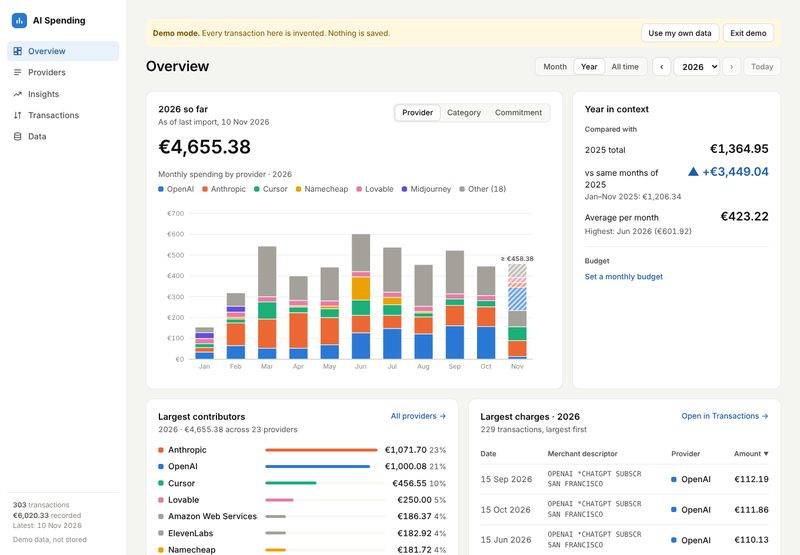 Overview, year view |
| 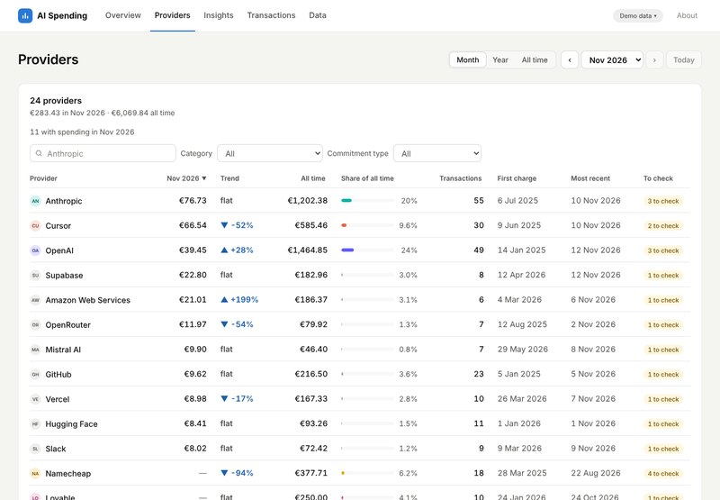 Providers | 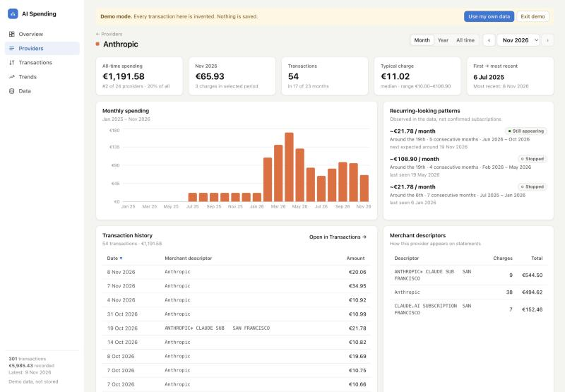 Provider detail |
| 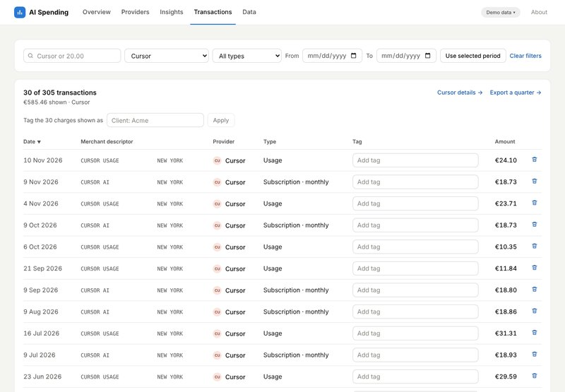 Filtered transactions | 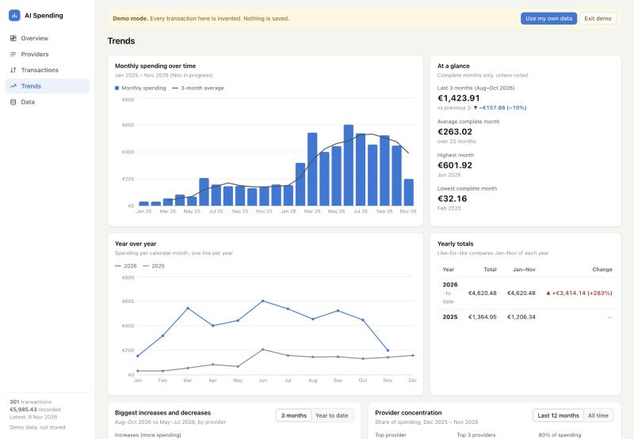 Trends |
| 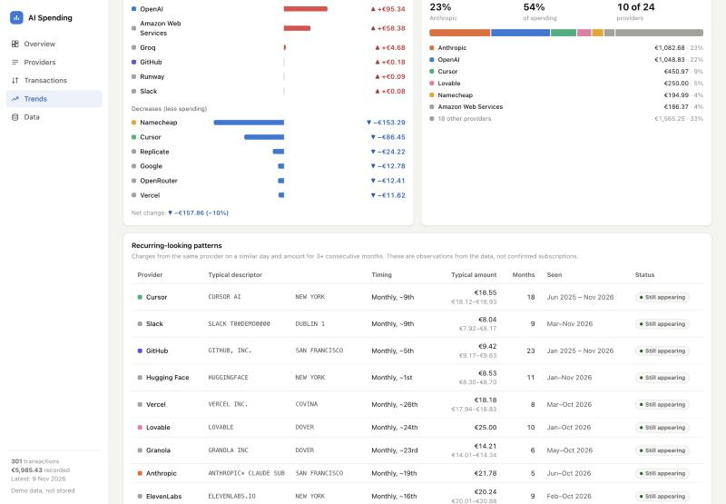 Changes, concentration, recurring | 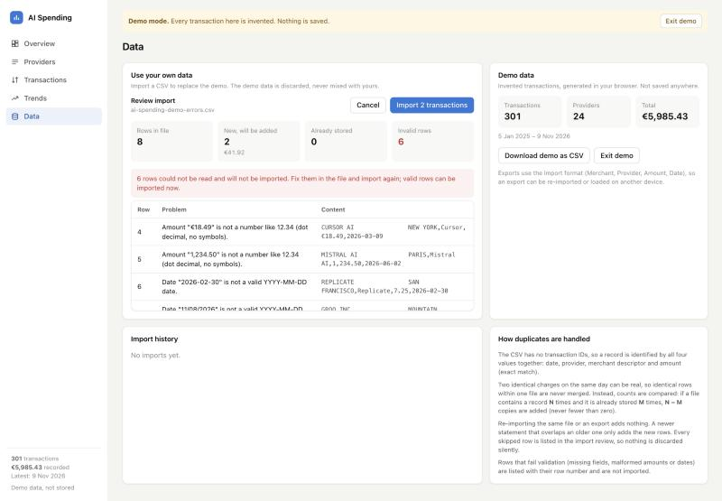 Import review with errors |
| 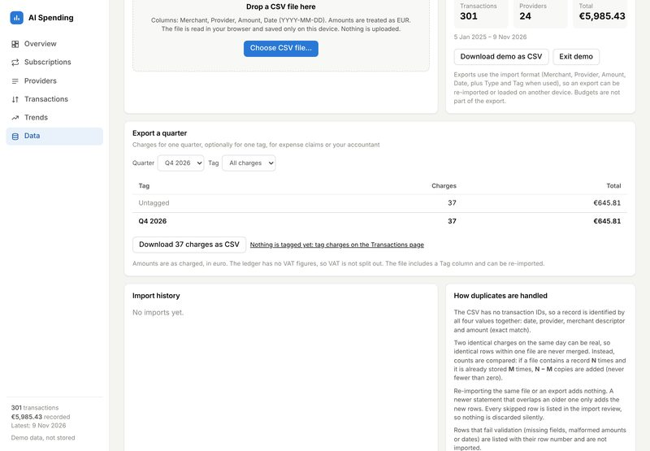 Data management | 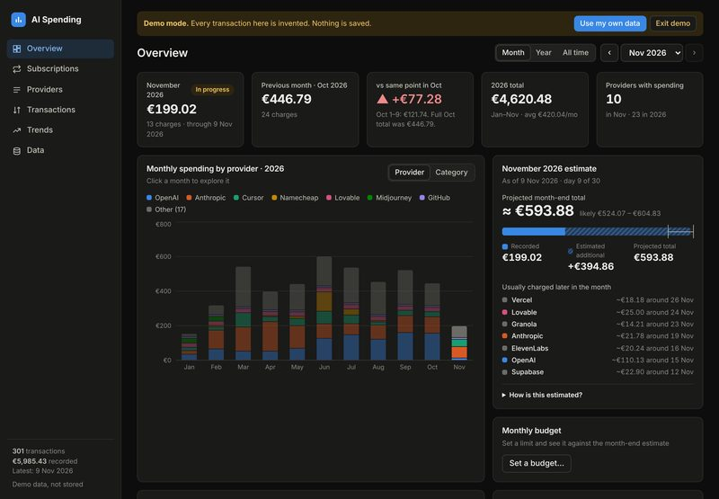 Dark mode |
| 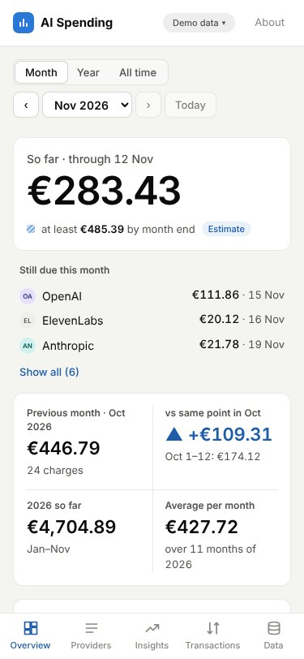 Mobile overview | 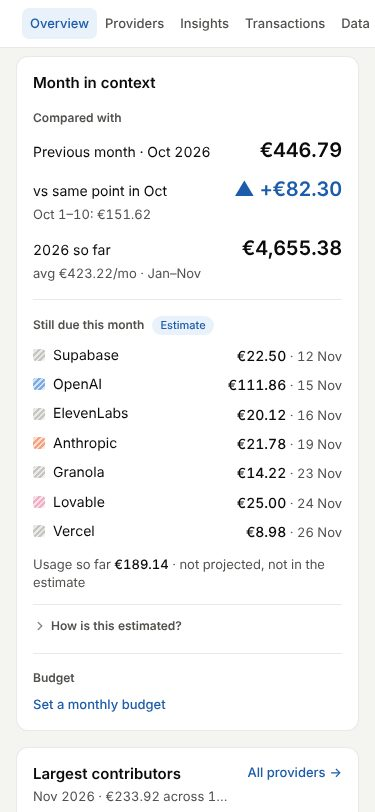 Mobile estimate |
| 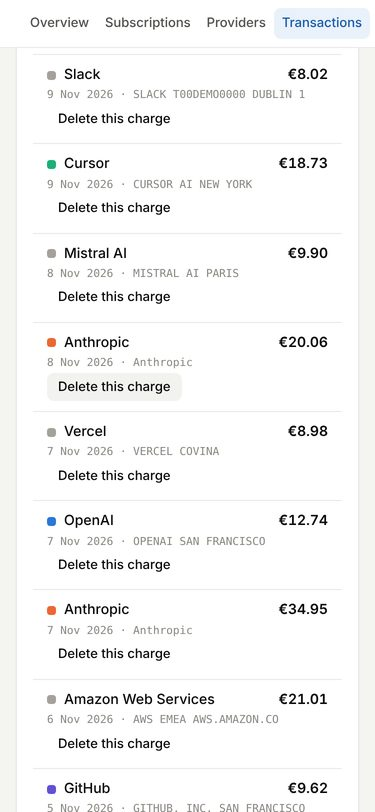 Mobile transactions | 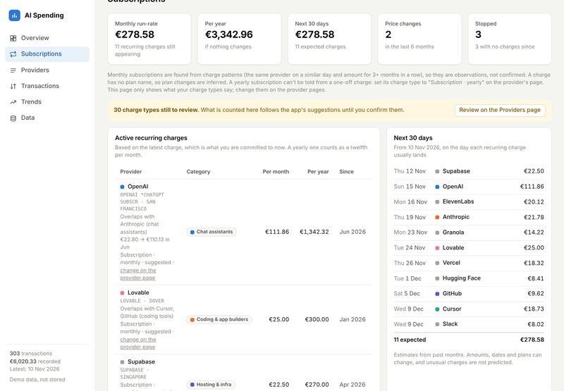 Subscriptions: run-rate, calendar, Type control |
| 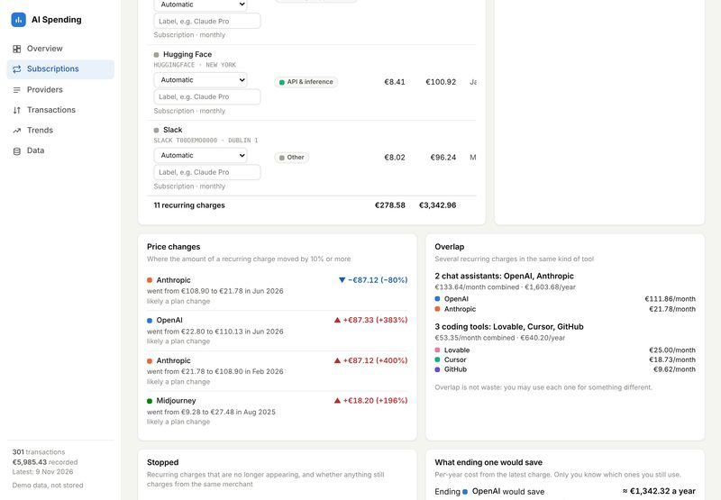 Price changes, overlap, stopped | 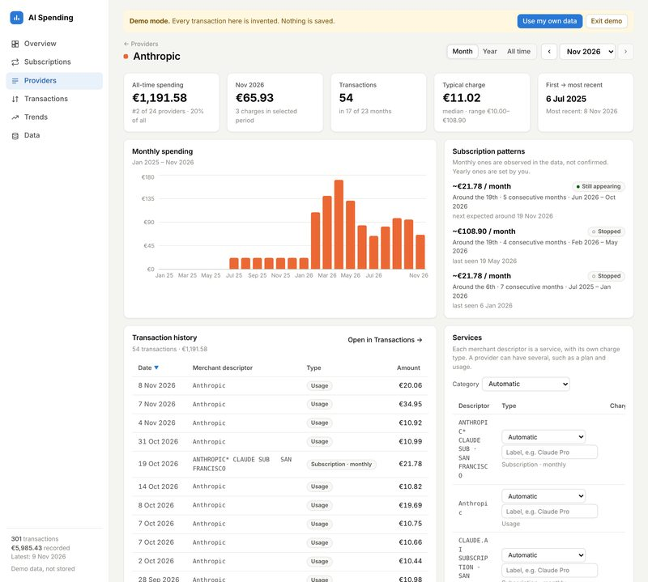 Provider services: type, label and category |
| 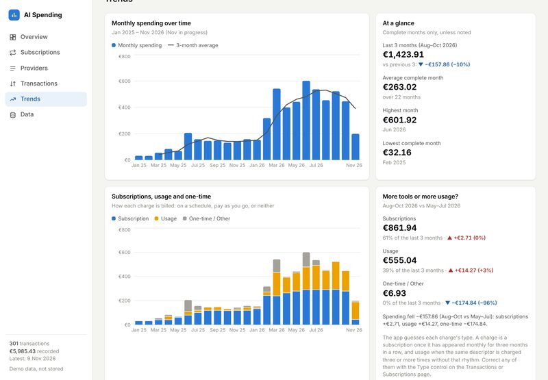 Trends: subscription, usage and one-time | 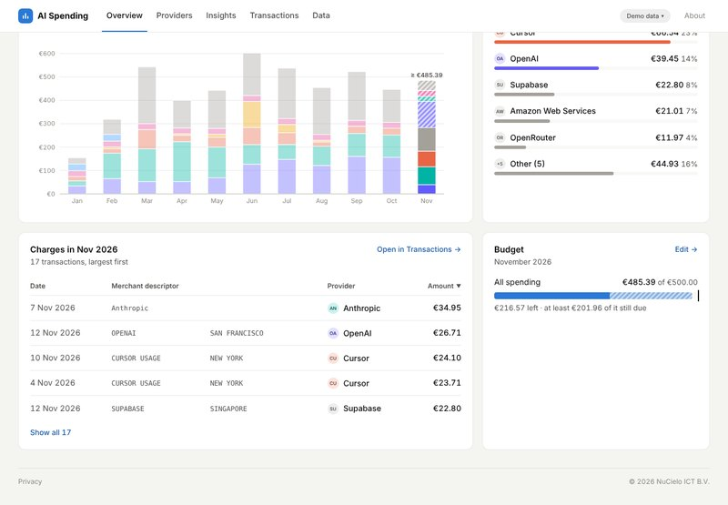 Monthly budget against the estimate |
| 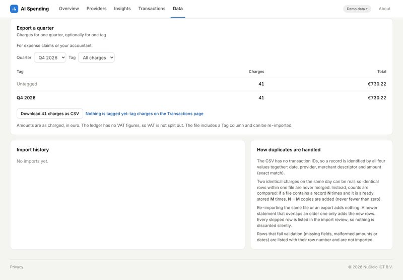 Export a quarter | |

All screenshots show the synthetic demo data.

## Pages

| Address | What | Source |
|---|---|---|
| `/` | Landing page: what it is, privacy up front, screenshots, FAQ. Static HTML, no scripts except a tiny redirect for old `/#/…` links. | `index.html`, `src/content/landing.ts` |
| `/app` (`app.html`) | The tracker. `/app?demo=1` starts the demo. | `app.html`, `src/` |
| `/privacy` (`privacy.html`) | The privacy statement (draft until reviewed). Static HTML. | `privacy.html`, `src/content/privacy.ts` |

The landing page and the privacy page are generated at build time from `src/content/`, so the wording lives in one file. The privacy statement is checked against the code by `src/content/privacy.test.ts`. The landing page leaves out the canonical link and social image until a public address is known: set `SITE_URL` (or, on Vercel, the production domain is used) and rebuild.

## Project layout

```
src/
  content/        landing page and privacy statement text, with tests
  lib/            pure logic, no React
    money.ts        cents parsing/formatting
    dates.ts        YYYY-MM-DD / YYYY-MM helpers
    csv.ts          parse + validate, export
    dedupe.ts       duplicate policy
    db.ts           IndexedDB (idb)
    analytics.ts    aggregation, periods, comparisons, concentration
    recurring.ts    recurring-looking pattern detection
    forecast.ts     current-month estimate
    colors.ts       provider colour assignment
    extract/        statement extractor: readers (table, Revolut PDF), vendor catalog, classifier, Ask Claude
    *.test.ts       Vitest suites
    __fixtures__/   synthetic test ledger
  components/     charts, tables, import panel, shared UI
  pages/          Overview, Providers, ProviderDetail, Transactions, Trends, DataPage
  store.tsx       loads data from IndexedDB, shared state
  router.ts       tiny hash router
  lib/demoData.ts   synthetic demo generator (runs in the browser and in the CLI)
scripts/          generate-demo-data.ts (writes the demo pack to disk)
public/demo/      synthetic demo pack (the only data files that get deployed)
vercel.json       Vercel build settings and security headers
private/          your real ledgers for local checks (git-ignored, never committed)
inbox/            raw bank/card statements for local checks (git-ignored, never committed)
```

Stack: React 19, TypeScript, Vite, Recharts, PapaParse, idb, pdf.js and read-excel-file (statements), Anthropic SDK + zod (Ask Claude, loaded only when used). Dev: Vitest, fake-indexeddb.
