# Screenshots

| | |
|---|---|
| 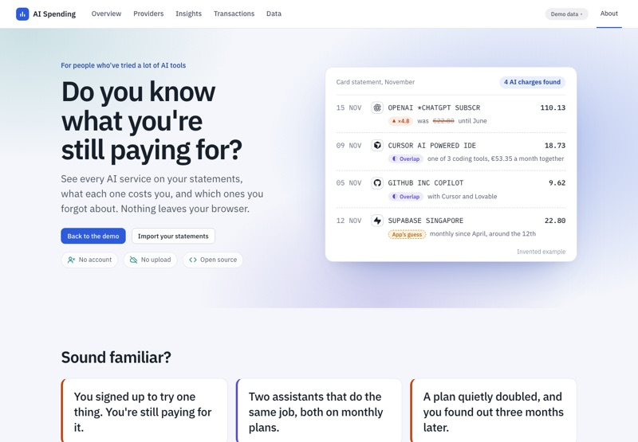 Welcome page | 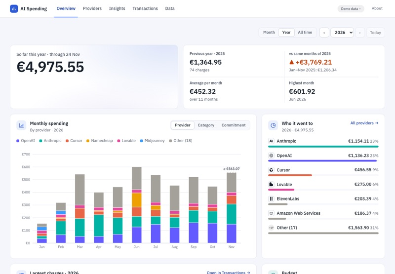 Overview, year view |
| 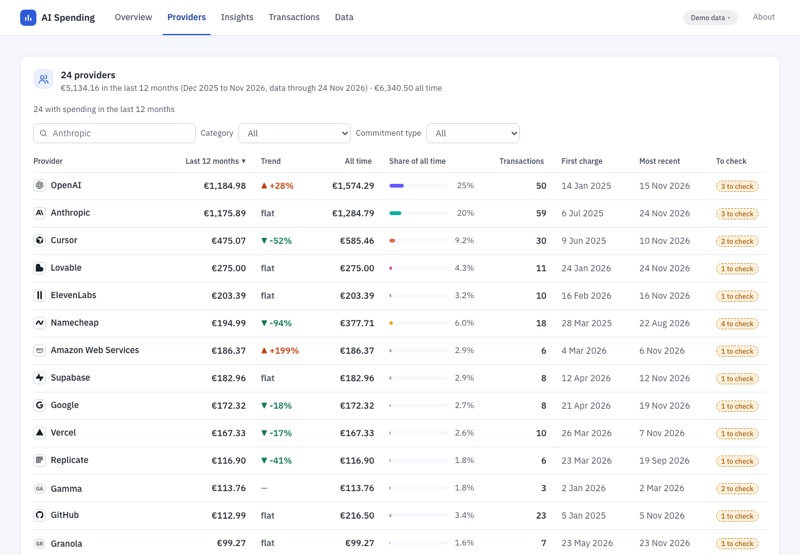 Providers: trend and filters | 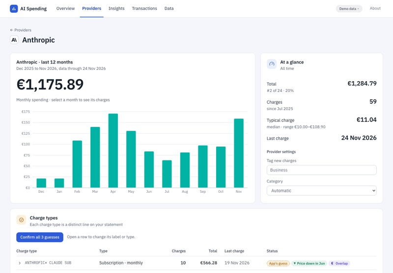 Provider detail: chart, at a glance and charge types |
| 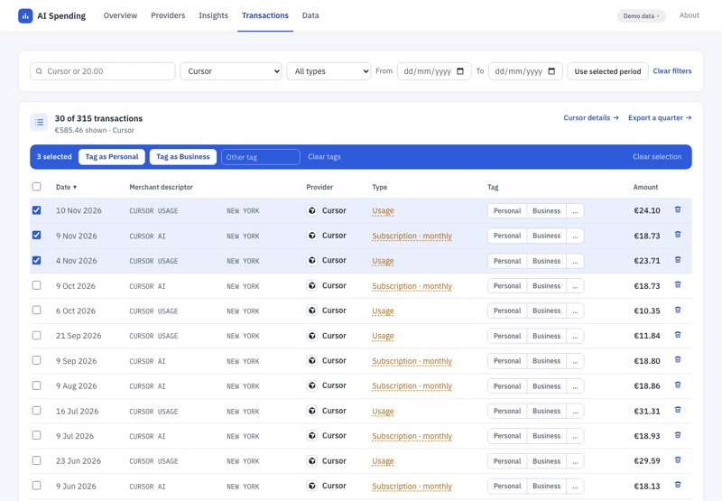 Filtered transactions, three ticked for bulk tagging | 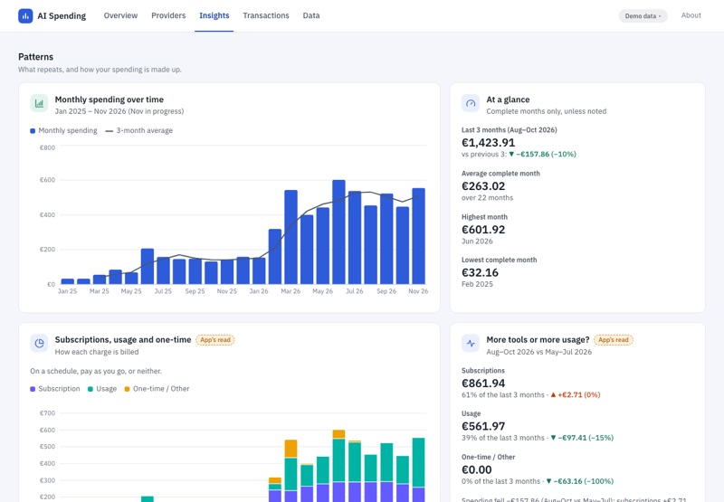 Insights: patterns |
| 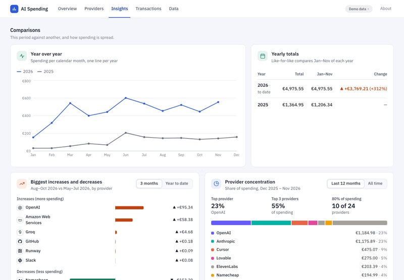 Insights: comparisons | 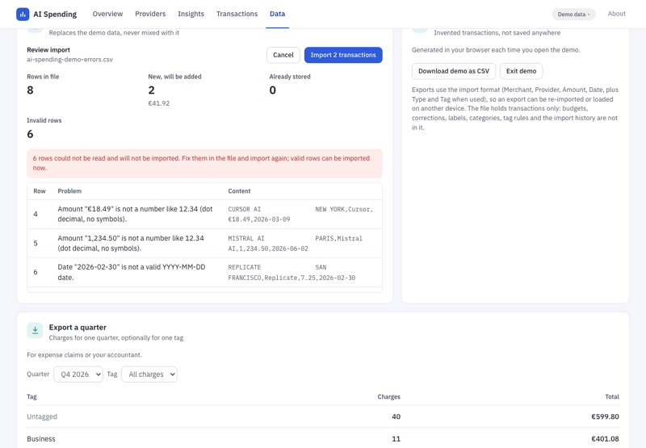 Import review with errors |
| 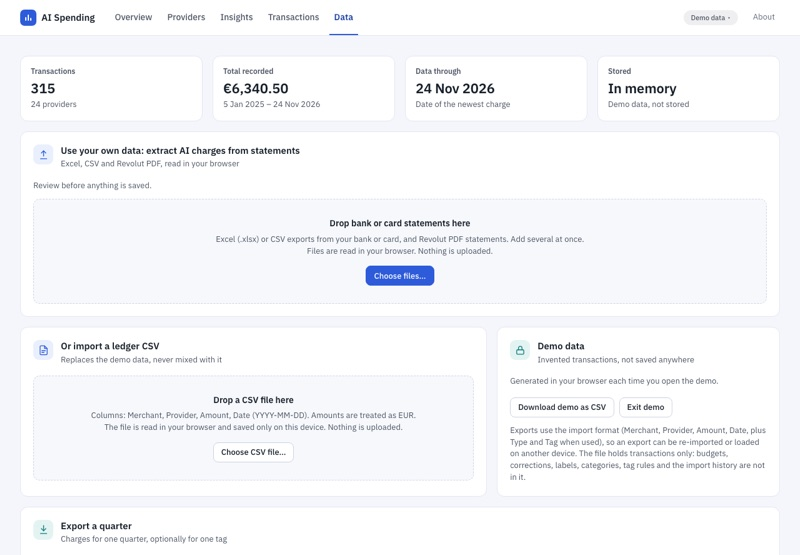 Data management | 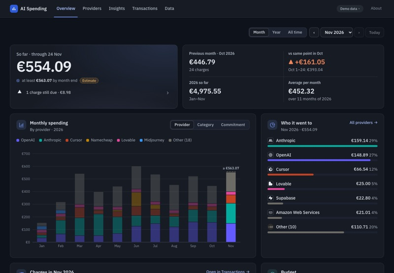 Dark mode |
| 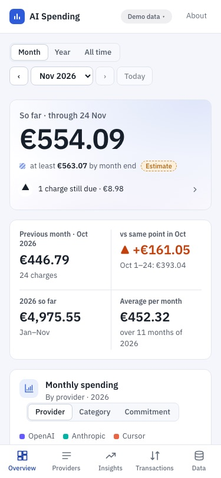 Mobile overview | 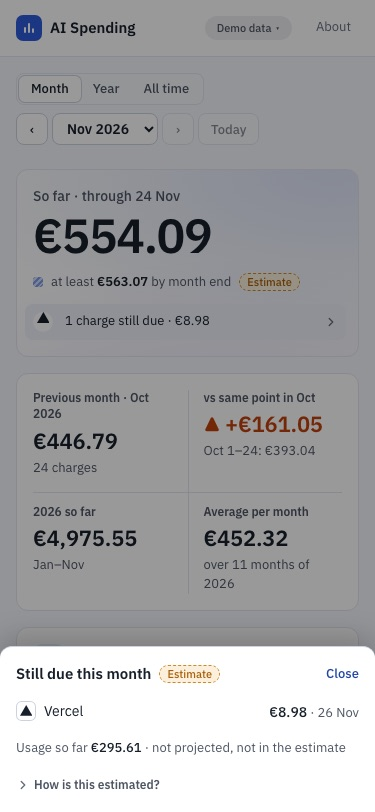 Mobile: what is still due this month |
| 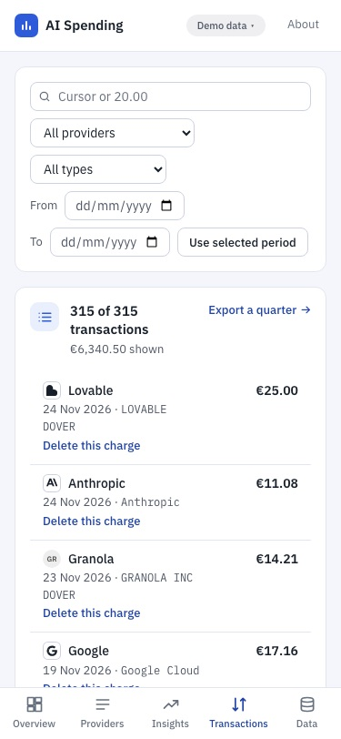 Mobile transactions | 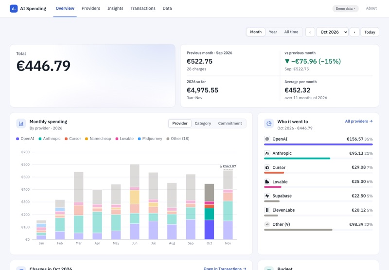 A past month: total, no estimate, its bar selected |
| 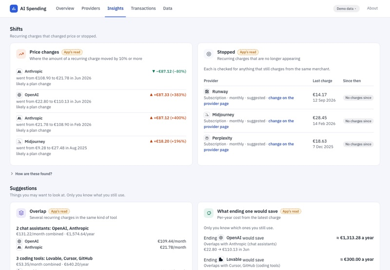 Insights: price changes, stopped, overlap | 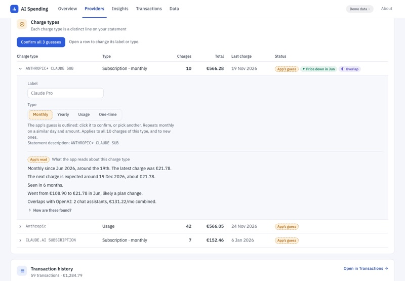 Charge types: the open row, with the app's guess outlined to confirm in one click |
| 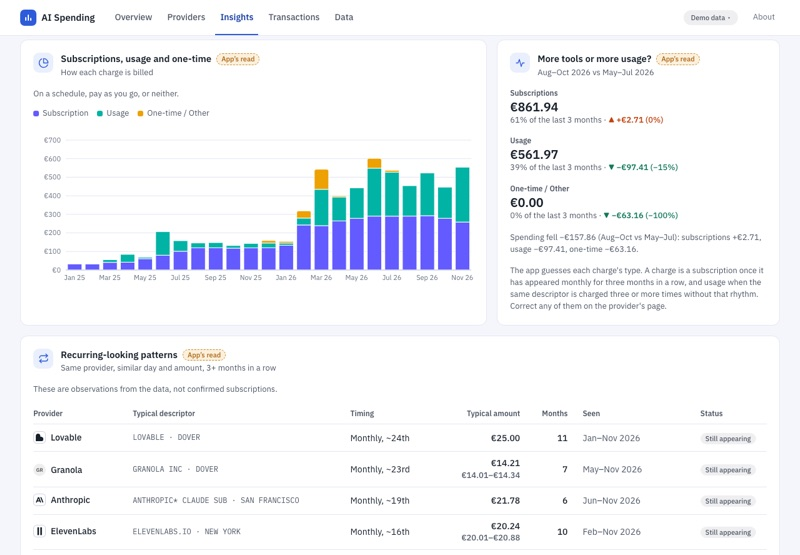 Insights: subscription, usage and one-time | 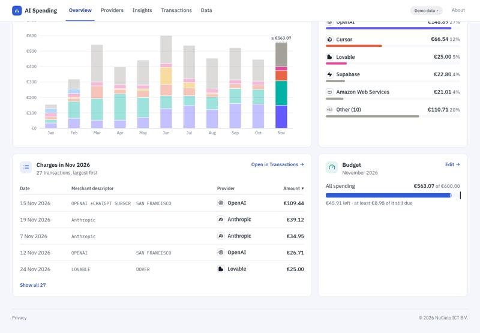 Monthly budget against what is recorded plus what is still due |
| 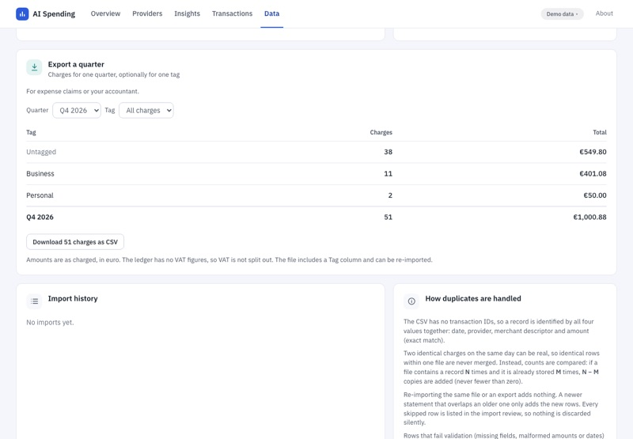 Export a quarter | |

All screenshots show the synthetic demo data.
